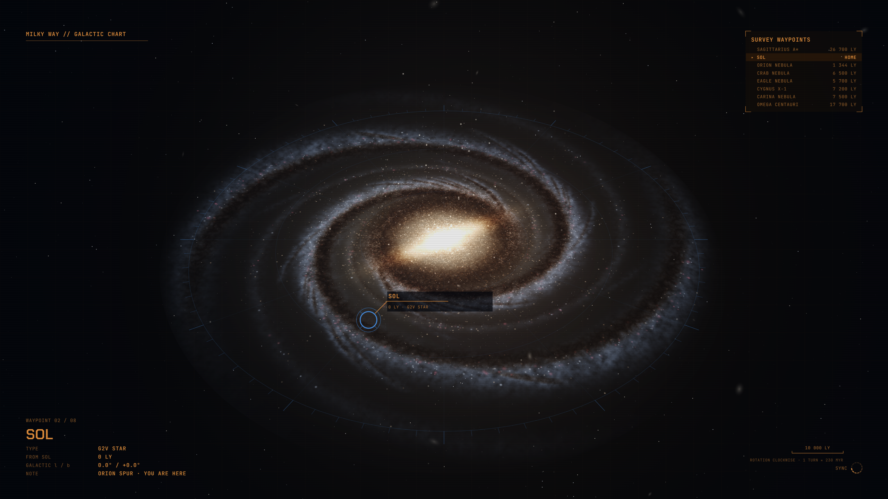

# Holoframe · Galactic Chart

An [Omarchy](https://omarchy.org) theme with an animated Milky Way under an orange survey HUD.



The Milky Way seen from above its north pole, turning slowly clockwise as the real galaxy does. It is
painted in natural colour from layers of light and dust: a white-hot central bar, two broad major arms
(Scutum–Centaurus and Perseus) springing from the bar's tips, faint broken minor arms (Sagittarius and
Norma), dust lanes that dim and redden the light behind them, pink star-forming nebulae and about a
million individual stars. The disk is drawn in 3D with perspective and the outer warp, thick-disk stars
and about 150 globular clusters float above and below the plane, and a faint chart grid and compass ring
sit beneath it.

A survey reticle circles eight real landmarks in turn, each placed from its galactic longitude, latitude
and distance: Sagittarius A*, the Sun, the Orion, Crab, Eagle and Carina nebulae, Cygnus X-1 and Omega
Centauri.

Holoframe is a set of six themes, each a hologram-style scene with bracketed HUD panels and live
readouts. Every scene is based on real engineering or physics, and all artwork is original and drawn
in code.

## Install

```bash
omarchy theme install https://github.com/toasty-sunbeam/omarchy-holoframe-galactic-theme.git
```

## What's included

| File | Purpose |
|---|---|
| `backgrounds/1-galactic-loop.mp4` | Seamless 120-second animated background (2560×1600, H.264, 25 MB): half a turn of the galaxy, which looks identical after half a turn, so the loop has no seam. The default. |
| `backgrounds/2-galactic-still.png` | Still version (3072×1920). Switch with `omarchy theme bg next`. |
| `colors.toml` | Orange HUD palette on navy-black, plus a gradient window border. |
| `shell.lock.toml` | Lock screen password field: a translucent card with thick side edges that light up while you type. |
| `icons.theme` | Matching Yaru icon colour. |

Omarchy generates terminal, editor and app colours from `colors.toml`.

## Pausing the animation

Video backgrounds are played by Omarchy's wallpaper daemon, OWE, which already pauses during fullscreen apps. To pause or resume by hand:

```bash
owe pause
owe resume
```

To toggle it with Super+Alt+P, add this to `~/.config/hypr/bindings.lua`:

```lua
o.bind("SUPER + ALT + P", "Pause background animation",
  [[sh -c 'if owe status | jq -e .manual_pause >/dev/null; then owe resume; else owe pause; fi']])
```

## Notes

- The HUD is sized for a 2× display at a 16:10 aspect ratio (rendered for a 3072×1920 panel). It works on other screens, with the HUD text slightly larger or smaller.
- The lock screen shows the current background frozen, with Omarchy's own password field at the centre.
- The look is inspired by the holographic loading screens of Mass Effect 2. This project is not affiliated with or endorsed by BioWare or Electronic Arts, and contains no assets from the game.

## Other Holoframe variants

- [Orbital Watch](https://github.com/toasty-sunbeam/omarchy-holoframe-orbital-theme) (green)
- [Dyson Swarm](https://github.com/toasty-sunbeam/omarchy-holoframe-dyson-theme) (orange)
- [O'Neill Habitat](https://github.com/toasty-sunbeam/omarchy-holoframe-oneill-theme) (magenta)
- [Cycler Navigation](https://github.com/toasty-sunbeam/omarchy-holoframe-cycler-theme) (blue)
- [Tokamak Reactor](https://github.com/toasty-sunbeam/omarchy-holoframe-tokamak-theme) (amber)

## License

[MIT](LICENSE)
